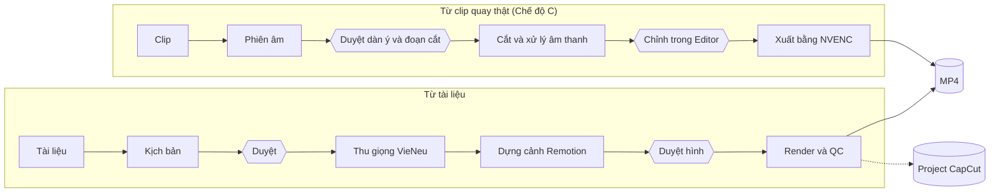

<div align="center">

# TVHs-Labs-Videos

**Xưởng video đào tạo của Thành Vinh Holdings: từ tài liệu hoặc clip quay thật đến MP4.**


[](https://www.remotion.dev)

[Bắt đầu nhanh](#bắt-đầu-nhanh) · [Hai luồng làm video](#hai-luồng-làm-video) · [Tài liệu](#tài-liệu) · [Quy định nội bộ](#quy-định-nội-bộ)

</div>

---

Repo này chạy cùng các công cụ AI (Claude Code, Antigravity): 18 nhân sự theo tổ Specialist viết kịch bản, dựng cảnh và kiểm tra, còn người phụ trách duyệt ở những điểm quan trọng.

## Hai luồng làm video



Khổ hình chọn cho từng video: 16:9, 9:16, 4:5, 1:1 ở luồng tài liệu; 16:9 hoặc 4:5 ở Chế độ C.

## Bắt đầu nhanh

### Cần có

| | Tối thiểu |
| :--- | :--- |
| Hệ điều hành | Windows 10 hoặc 11 |
| Node.js | 22 trở lên |
| GPU | NVIDIA, driver 550 trở lên. Không có thì luồng tài liệu chạy bằng CPU, chậm hơn nhiều; Chế độ C cần NVIDIA |
| Ổ đĩa trống | 30 GB, thêm 25 GB nếu cài Chế độ C |

### Cài đặt

```powershell
git clone https://github.com/chusaubanh/TVHs-Labs-Videos.git
cd TVHs-Labs-Videos
npm run setup
npm run doctor
```

Chế độ C cài thêm bằng `npm run th:setup`. Tài liệu đào tạo, clip và video đã làm không nằm trong git; chép riêng vào `input/` khi cần.

### Bản đồ mã nguồn Graphify

Trên máy mới, cài Graphify bằng `uv tool install graphifyy`. Tại thư mục dự án, chạy `npm run graph` để cập nhật bản đồ mã và tạo lại [bản xem tổng quan](graphify-out/graph-overview.html), [đồ thị đầy đủ](graphify-out/graph.html) và [báo cáo](graphify-out/GRAPH_REPORT.md).

Chạy `graphify query "Remotion render từ kịch bản như thế nào?"` để tra một luồng cụ thể. Trong Codex, dùng `$graphify` sau khi mở lại dự án để nạp skill. [Hướng dẫn Graphify](https://graphiffy.com/docs/install)

### Làm thử video mẫu

Mở một cửa sổ PowerShell và bật máy chủ giọng đọc:

```powershell
npm run tts:server
```

Rồi chạy ở cửa sổ khác:

```powershell
mkdir "output\Pha-tra"; copy "samples\Pha-tra\script.json" "output\Pha-tra\"

npm run script:validate -- "Pha-tra"
npm run approve -- "Pha-tra" script --by "tên bạn"
npm run voice -- "Pha-tra"
npm run stills -- "Pha-tra"
npm run approve -- "Pha-tra" visual --by "tên bạn"
npm run render -- "Pha-tra"
```

Video nằm ở `output/Pha-tra/video.mp4`.

## Tài liệu

| Cần | Tài liệu |
| :--- | :--- |
| Kết nối kho repo và thiết kế khai thác 20 công cụ | [docs/THIET-KE-TICH-HOP-REPO.md](docs/THIET-KE-TICH-HOP-REPO.md) |
| Các bước và lệnh làm một video | [docs/QUY-TRINH.md](docs/QUY-TRINH.md) |
| 18 nhân sự theo tổ Specialist, ai giữ file nào | [docs/18-NHAN-SU.md](docs/18-NHAN-SU.md) |
| Dựng từ clip quay thật, Editor, Premiere | [docs/CHE-DO-C.md](docs/CHE-DO-C.md) |
| Quy chuẩn viết kịch bản | [docs/QUY-CHUAN-KICH-BAN.md](docs/QUY-CHUAN-KICH-BAN.md) |
| Quy chuẩn hình | [docs/QUY-CHUAN-HINH.md](docs/QUY-CHUAN-HINH.md) |
| Nghiên cứu, bằng chứng, quyết định | [docs/NANG-CAP-NHAN-SU.md](docs/NANG-CAP-NHAN-SU.md) |
| Hợp nhất repo cũ và đóng gói | [docs/KE-HOACH-HOP-NHAT-VA-DONG-GOI.md](docs/KE-HOACH-HOP-NHAT-VA-DONG-GOI.md) |

## Cấu trúc thư mục (Phân cấp gọn gàng)

Thư mục gốc được thiết kế tối giản, tách biệt hoàn toàn khu vực làm việc của người dùng và động cơ kỹ thuật:

```text
📁 input/                  Tài liệu nguồn bạn đưa vào để làm video
📁 output/                 Video thành phẩm, kịch bản, timeline, ảnh duyệt
📁 assets/                 Thương hiệu, nhạc nền, SFX, font chữ
📁 docs/                   Toàn bộ tài liệu quy chuẩn, kịch bản mẫu, lưu trữ
📁 engine/                 Động cơ kỹ thuật & mã nguồn (Remotion, Scripts, AI models, node_modules)
🚀 1-Mo-Ung-Dung.bat       Khởi động Web Studio 1-click
🚀 2-Kiem-Tra-He-Thong.bat Kiểm tra môi trường & sức khỏe hệ thống (Doctor)
🚀 3-Xuat-Video.bat        Xuất video thành phẩm nhanh
```

## Kiểm tra hệ thống

```powershell
npm run typecheck
npm test
npm run gate:determinism -- --fixtures
```

## Quy định nội bộ

- **Không công khai repo này.** Repo có logo, tên công ty, tài liệu và nhạc nội bộ.
- **Nhạc nền chỉ dùng nội bộ.** Xem `public/audio/NGUON.md`.
- **Giấy phép Remotion:** đơn vị vì lợi nhuận có trên 3 nhân viên phải mua Company License. Xem [remotion.dev/license](https://www.remotion.dev/license).
